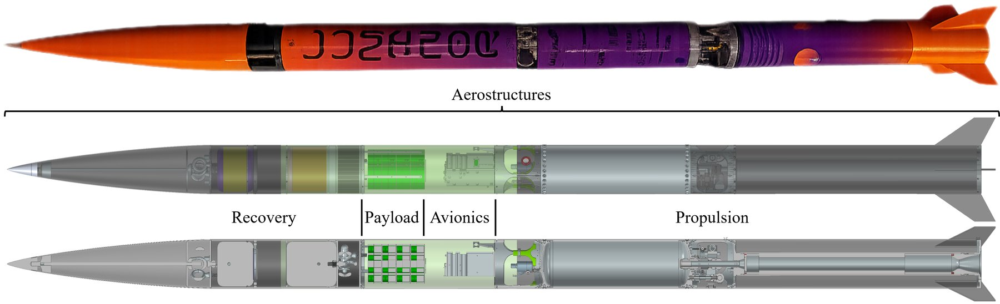
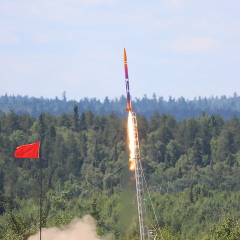
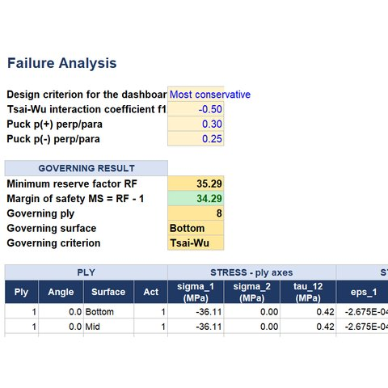
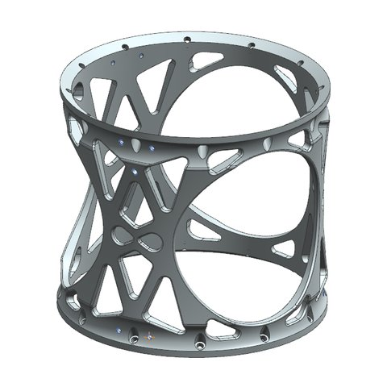
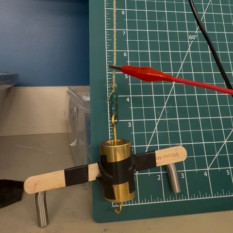
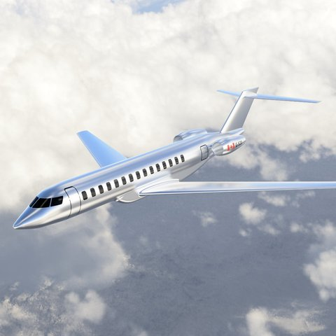

# Pierre Arbaji

**B.Eng. Mechanical Engineering, Aerospace Minor · McGill University · Expected April 2027**

Mechanical design · Aerospace structures · Composites and manufacturing

[**Engineering Portfolio (PDF)**](Pierre-Arbaji-Engineering-Portfolio.pdf) &nbsp;·&nbsp; [LinkedIn](https://www.linkedin.com/in/pierre-arbaji-273441258) &nbsp;·&nbsp; [pierre.arbaji@mail.mcgill.ca](mailto:pierre.arbaji@mail.mcgill.ca)

  
   
  Project Luminor, McGill Rocket Team: flight vehicle and aerostructures architecture. 3rd place, Launch Canada (Advanced category).

## About

I design, analyse, build and test load-bearing structures. Most of that work has been on rocket hardware (composite airframes, machined metallic interfaces, a pressure vessel), because student rocketry hands the entire design loop to undergraduates: requirements, sizing, finite element analysis, tooling, manufacturing, testing and flight. Internships in aerostructures at Airbus and in advanced composite structures at Bombardier, and undergraduate research on polymer actuators for architected metamaterials, have extended the same interest in how structures and materials behave and how far they can be pushed.

**Current work (2026–27):** Design and Optimization Advisor, McGill Rocket Team. Capstone project on the design, manufacture and ground testing of a one-piece composite fin can for the team's supersonic two-stage vehicle.

## Engineering Portfolio

The [**portfolio**](Pierre-Arbaji-Engineering-Portfolio.pdf) (19 pages, updated September 2026) documents the engineering behind each project rather than repeating my CV: the requirements each design answered, the decisions and trade-offs, how the analysis was checked, and what testing and flight showed.

<table>
  <tr>
    <td width="190"></td>
    <td>
      <b>1 · Project Luminor: rocket aerostructures</b> (p. 2) 
      <i>Hybrid rocket, McGill Rocket Team · Aerostructures Subteam Lead, subteam of ~50 students</i>  
      3rd place at Launch Canada (Advanced category); structure recovered with no damage; aerostructures mass 13.35 kg against an 18.1 kg budget; full vehicle assembled in under one hour. 
      Architecture · composite design · tooling and prepreg layup · FEA · CNC interfaces · pressure vessel · integration
    </td>
  </tr>
  <tr>
    <td width="190"></td>
    <td>
      <b>2 · Classical laminate theory design tool</b> (p. 7) 
      <i>Individual project, used to size Luminor's composite airframe</i>  
      24 benchmark quantities agree within 0.05% with an independent Python implementation; the laminates it sized flew without damage. 
      CLT (ABD) · six failure criteria including Tsai–Wu, Hashin and Puck · shell and panel buckling · independent verification
    </td>
  </tr>
  <tr>
    <td width="190"></td>
    <td>
      <b>3 · Structural redesign: load-path and topology optimization</b> (p. 10) 
      <i>Two flight components for the team's next, higher-apogee vehicle</i>  
      Recovery interface 85% lighter (1.575 kg to 0.230 kg); propulsion cage bending factor of safety raised from 1.50 to 2.10 with 17.7% less mass. 
      Load-path redesign · topology optimization · design for three-axis machining · mesh convergence
    </td>
  </tr>
  <tr>
    <td width="190"></td>
    <td>
      <b>4 · Research: supercoiled polymer muscles for bistable metamaterials</b> (p. 15) 
      <i>Architected Metamaterials Group, McGill · Undergraduate Research Assistant · co-author</i>  
      12% stroke against a 2.84 N load (2.0 N required); failure mechanism identified; integration concept designed. 
      Fabrication · electro-thermal testing · failure analysis · integration design
    </td>
  </tr>
  <tr>
    <td width="190"></td>
    <td>
      <b>5 · Aircraft conceptual design: long-range business jet</b> (p. 18) 
      <i>AERO 520 aircraft design, team of four · led the structural layout</i>  
      Takeoff and landing field lengths of 5,234 ft and 5,206 ft against a 6,000 ft limit; 1.9% range shortfall traced to cruise L/D. 
      Constraint sizing · performance · stability and trim · structural layout
    </td>
  </tr>
</table>

## Additional Projects

Earlier coursework and research, each with a short summary and the full report.

| Project | Context | Summary |
|---|---|---|
| [Active roll control for a model rocket](additional-projects/active-roll-control/) | Undergraduate research, McGill Rocket Team · Summer 2025 | Fin-mounted, servo-actuated roll control; roll dynamics and a PID controller with feed-forward and anti-windup, simulated in MATLAB over an OpenRocket flight profile |
| [Structural bracket: FEA and test to failure](additional-projects/structural-bracket/) | MECH 321 Mechanics of Deformable Solids · Winter 2025 | Laser-cut acrylic bracket designed in Abaqus and tested to failure; the gap between FEA and test is quantified |
| [Motorcycle hazard-warning system](additional-projects/motorcycle-hazard-warning/) | MECH 292 Conceptual Design · Winter 2025 | Requirements, house of quality, morphological chart and weighted Pugh matrix leading to a dashboard warning display |

## Skills

- **CAD:** Siemens NX, SolidWorks, CATIA
- **Analysis:** Nastran, Ansys and Abaqus (FEA); classical laminate theory; topology optimization
- **Programming:** MATLAB, Python, C++ (Arduino), Excel
- **Flight and aerodynamics:** OpenRocket, RocketPy, XFOIL, AAA (Advanced Aircraft Analysis)
- **Manufacturing:** prepreg and wet layup, vacuum consolidation and oven cure, composite tooling, honeycomb sandwich panels, design for CNC machining, additive manufacturing
- **Languages:** English, French, Spanish, Portuguese, Arabic

## Contact

[pierre.arbaji@mail.mcgill.ca](mailto:pierre.arbaji@mail.mcgill.ca) · [LinkedIn](https://www.linkedin.com/in/pierre-arbaji-273441258)
