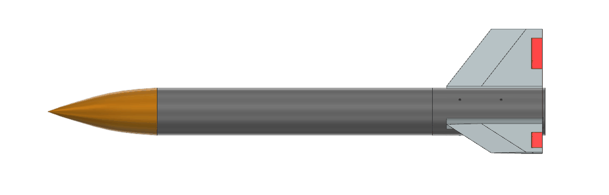
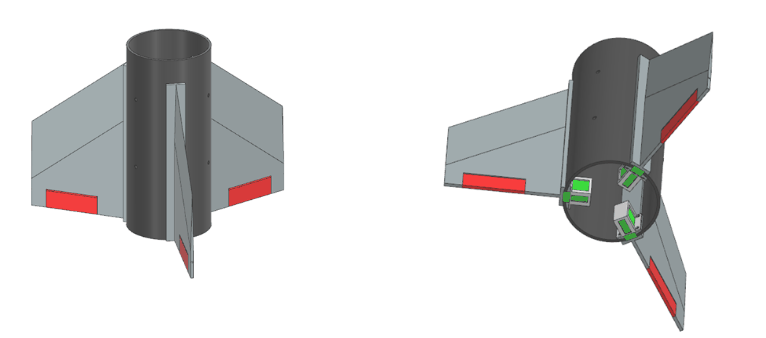
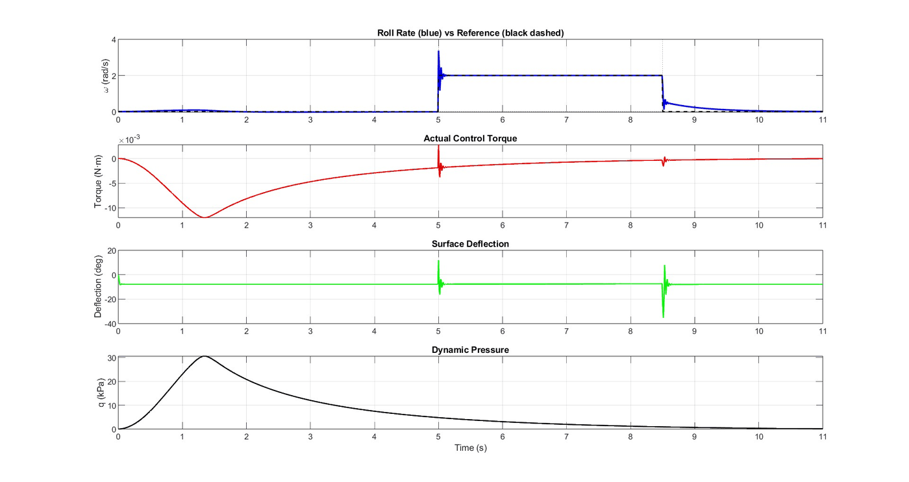

[Pierre Arbaji](../../README.md) / [Additional projects](../README.md) / Active roll control

# Active roll control for a model rocket

Undergraduate research · McGill Rocket Team, Active Flight Controls · May to August 2025 
Co-authored with Majd Boulos · Funded by an $11,500 McGill Engineering Undergraduate Society grant, which I initiated and secured

Full report: [Design, Modeling, and Testing of an Active Roll Control System for a Model Rocket Using Fin-Mounted Control Surfaces](Active-Roll-Control-System-Report.pdf) (32 pages, MATLAB source included)

  

## Problem

The McGill Rocket Team's long-term plan includes active flight control. This project was the first step: closed-loop control of roll rate using servo-driven control surfaces. Launch Canada's rules frame the design. Control is limited to roll, pitch and yaw, with guidance prohibited. The vehicle must stay stable with the system inactive, failsafes are required, and the system must remain dormant during the thrust phase.

## Design

We compared fin-mounted trailing-edge surfaces with canards on stability, responsiveness, mechanical and electrical complexity, servo torque and drag. Fin-mounted surfaces won because they preserve passive stability and are simpler to build, which suits a first roll-only iteration. Canards were noted as the better option for full three-axis control.

The testbed is a single-stage solid-motor rocket: Aerotech I300T, 36.2 in long, 3.5 in diameter, 1.06 calibre static margin and about 3,300 ft predicted apogee. It was deliberately not optimised for mass or drag, so that the control hardware could be iterated quickly. Its three clipped-delta fins each carry a servo-driven control surface, and each fin is a detachable module with its servo and surface, so final assembly only requires connecting wiring to the avionics bay.

Hinge torque was estimated at about 0.09 N·m at maximum velocity. With a factor of safety of 2, an EMAX ES08MA II servo (2.0 kgf·cm at 6 V) was selected. The flight computer is an Arduino Mega with a 10-DOF IMU, and the IMU code was written and calibrated in C++.

  

## Modelling and control

An OpenRocket model of the testbed provided the velocity and altitude profiles for the controller simulation. A MATLAB model integrates the roll equation of motion at 100 Hz. Control torque scales with dynamic pressure (ISA atmosphere), aerodynamic damping opposes roll, and a fixed 1.5° fin cant applies a persistent disturbance torque.

The controller is a torque-domain PID with a filtered derivative and a feed-forward term that cancels the cant torque. The actuator model has ±45° surface travel, a 0.5° hinge deadband and a 20 ms first-order servo lag. Torque saturation and back-calculation anti-windup protect the integrator, and a low-dynamic-pressure guard bleeds the integrator and parks the surfaces when there is no control authority.

## Results

In simulation over the flight profile, the controller:

- regulated roll rate to zero against the cant disturbance;
- tracked a 0 → 2 → 0 rad/s roll-rate command, with a brief saturation followed by an exponential approach, minimal chatter and no integrator windup;
- with a cascaded outer angle loop, performed two sequential +90° roll manoeuvres within an 11 s window while respecting the deflection and servo-lag limits.

  
   
  Roll-rate tracking (0 → 2 → 0 rad/s): roll rate against reference, control torque, surface deflection and dynamic pressure.

## Status and next steps

Validation so far is simulation-based. The next steps defined in the report are:

1. A full-scale flight test to measure real actuator response, aerodynamic effects and latency.
2. Re-tuning to reduce overshoot.
3. Accounting for structural vibration and aeroelastic effects.
4. Extending the system to pitch and yaw for full three-axis control.

The follow-on project, [Polaris Flight](../../polaris-flight/), moved to canards on a larger commercial airframe.

## My role

I initiated the project, secured its funding and set its scope. I derived the roll-axis dynamics, developed the closed-loop controller, and designed the test rocket and its actuation hardware.
