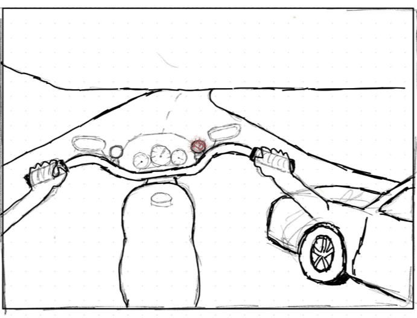
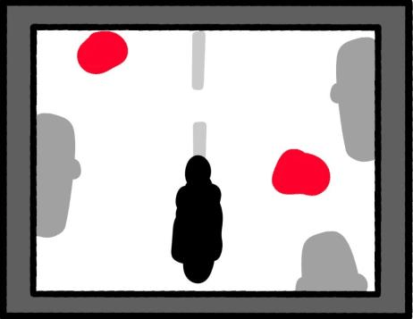

[Pierre Arbaji](../../README.md) / [Additional projects](../README.md) / Motorcycle hazard-warning system

# Motorcycle Hazard-Warning System: Conceptual Design

**MECH 292 Conceptual Design · McGill University · Winter 2025** 
Team of five · My role: research and development lead

**Full report:** [Conceptual Design Report](Motorcycle-Hazard-Warning-Conceptual-Design-Report.pdf) (12 pages)

## Problem

Motorcyclists are far more vulnerable than other road users, particularly to road defects (potholes, cracks, debris, wet patches) and to not being seen in other drivers' blind spots. Existing pothole-detection systems mostly serve municipal road crews and do not warn the rider in real time. Rider-facing systems such as on-bike sensors, head-up displays and AR warnings remained largely at the prototype stage.

## Process

- **Requirements.** A house of quality captured the requirements: accurate and reliable detection that distinguishes hazard types, real-time warning with minimal distraction, easy integration with existing bikes and gear, regulatory compliance, affordability and durability.
- **Concept generation.** A morphological chart covered four functions: communicating the hazard, characterising it, warning in time and integrating with the bike. It led to three concepts: an augmented-reality helmet, a dashboard screen, and mirror-mounted warning lights.
- **Selection.** A weighted Pugh matrix across seven criteria scored the dashboard screen 20, the warning lights 18 and the AR helmet 16.

  
  &nbsp;
  

## Outcome

The selected concept is a dashboard-mounted, high-brightness, anti-glare display. It is fed by ultrasonic sensors, an IMU and a GPS module through a microcontroller and single-board computer, all housed in a waterproof enclosure. The team also produced a bill of materials. The accepted trade-off is that the rider must glance down at the display. In return, the screen differentiates clearly between hazard types, and it is cheaper and more durable than a helmet-integrated system.

## My role

I led the market and technology research and developed the house of quality. I also contributed substantially to the morphological chart and the Pugh matrix.
