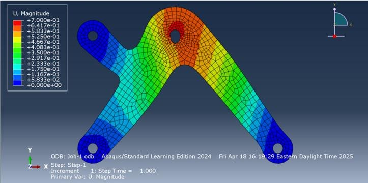
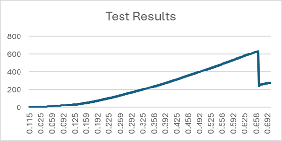
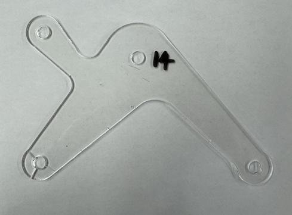

[Pierre Arbaji](../../README.md) / [Additional projects](../README.md) / Structural bracket

# Structural Bracket: Design, FEA and Test to Failure

**MECH 321 Mechanics of Deformable Solids · McGill University · Winter 2025** 
Team of two, with Michael Salameh (equal contribution)

**Full report:** [Design and Analysis of a Structural Bracket](Structural-Bracket-Report.pdf) (13 pages)

  

## Problem

The task was to design a laser-cut bracket in 3.0 mm acrylic (E = 2.8 GPa, tensile strength 69 MPa) that resists 300 N when its load pin is displaced 0.7 mm, at minimum mass. The design had to fit a 220 × 170 mm envelope with three fixed pins and one loaded pin. It could have at most five internal cut-outs, with a 10 mm minimum cutting radius and a 10 mm material boundary around every pin. Each manufactured part was weighed, stiffness-tested to 0.7 mm, then loaded to failure.

## Approach

- **Concept screening.** Several concepts were modelled in Abaqus with pinned boundary conditions and the imposed displacement. Thinner concepts were rejected because their peak von Mises stress was too high relative to the tensile strength.
- **Refinement.** The chosen concept was refined with local mesh control around the pin holes and a mesh convergence study, run within the 1,000-node limit of the student licence.
- **Design for manufacture.** The outline is a single smooth contour with no sharp corners. This reduces stress concentrations and laser-cutting time for batch production. The geometry was delivered as a DXF.
- **Strength prediction.** The applied load was iterated until the peak stress reached the tensile strength. This predicted failure at about 465 N at the loaded pin, where stress concentration is highest.

## Results

| | FEA prediction | Test |
|---|---|---|
| Reaction force at 0.7 mm | 290 N (target 300 N) | Specimen failed at 0.665 mm |
| Stiffness | 415 N/mm | 952 N/mm |
| Failure | About 465 N, at the loaded pin | 633 N, brittle tensile fracture |

  
  &nbsp;
  
   
  Left: measured reaction force (N) against displacement (mm), to fracture. Right: the specimen after failure.

The test article was about 2.3 times stiffer than predicted and carried 36% more load than the predicted failure load. The report attributes the gap to differences between the idealised simulation and the physical test. The lesson I took from it is that mesh convergence only verifies the numerics. Modelling assumptions such as boundary conditions, load introduction and material properties are validated only by a physical test.

## My role

Michael and I shared every part of the project: concept development, analytical estimates, Abaqus modelling and mesh convergence, design-for-manufacture review, DXF preparation, mechanical testing, data analysis and the report. I led the overall design process against the stiffness and mass targets, and I ran the mechanical testing.
