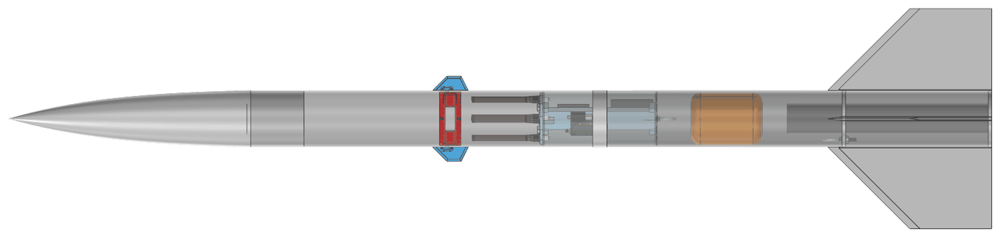
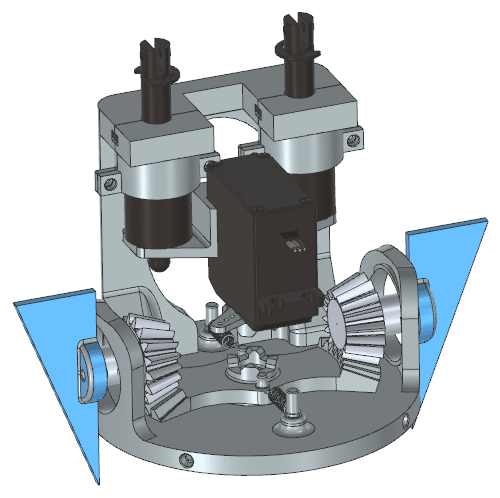
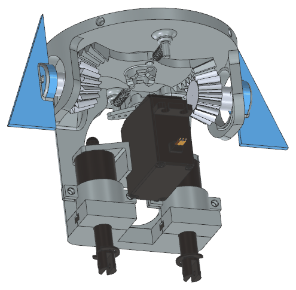
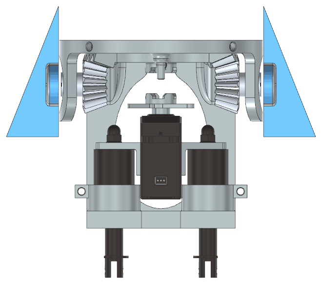
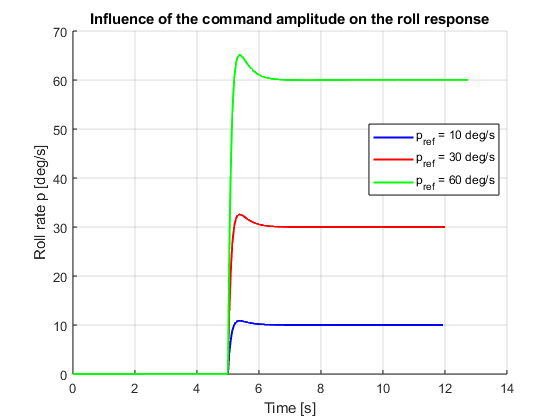
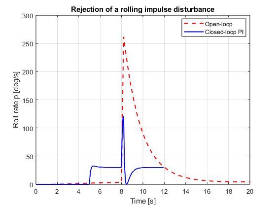

[Pierre Arbaji](../README.md) / Polaris Flight

# Polaris Flight: canard roll control for a high-power rocket

McGill Polaris Flight · Launch Canada 2026, Technology Development category · September 2025 to present 
Co-founder and Mechanical Lead · Spun off from the McGill Rocket Team and funded by the McGill Institute for Aerospace Engineering in summer 2025

Full report: [Preliminary design report for Launch Canada 2026](Polaris-Flight-Preliminary-Design-Report.pdf) (51 pages, January 2026)

> [!NOTE]
> Status: the design is complete, but the rocket has not been built or flown yet. We planned to fly it at Launch Canada in summer 2026, but we could not get insurance for the launch, so the flight was postponed. It is rescheduled for when the whole team is back in Montreal, in the Winter 2027 semester.

  

## Goal

Polaris is a test bed for active roll control on a commercial airframe. Launch Canada's 2026 rules allow active control only for roll stability or aerodynamic braking, never for guidance, so the flight needs a task that shows the controller working. Ours is to roll the rocket during coast so that its on-board camera points at our ground station. An on-board radio direction-finding system measures the bearing to the ground station's transmitter, and that bearing becomes the roll-angle command.

The vehicle is a modified LOC Precision IRIS 4 in kit, 69 in long, on an AeroTech K535W solid motor (1,434 N·s). OpenRocket predicts a 4,558 ft apogee, a maximum speed of 770 ft/s and a minimum static margin of 3.38 calibres, with about 12 s of coast for the controller to work in.

## Canard mechanism

Two canards sit just above the avionics bay, as close to the centre of gravity as practical, so that they add as little pitch and yaw moment as possible. One servo drives both. It turns a central bevel gear that meshes with a bevel gear on each canard shaft, so the two canards always move together and there is no mismatch between separate actuators. The module is designed to be mostly 3D printed, with internal channels for the servo wiring.

  
  &nbsp;
  

The servo was sized for the largest hinge moment in flight. At the maximum speed of 234 m/s and a 20° deflection, each 1.875 in² triangular canard needs 0.207 N·m. With a factor of safety of 2, the servo needs at least 0.414 N·m (4.22 kgf·cm) of stall torque.

## Fail-safe design

Launch Canada requires the control system to lock in a neutral position during boost. It must lock again whenever an abort signal is received, main power is lost, or the rocket tilts more than 30° from its launch angle. The mechanism meets this with a clutch that needs power to stay engaged.

The servo is mounted between two solenoids. While they are powered, they hold the servo up so that a clutch on its output engages the central bevel gear, and the servo can move the canards. If the flight computer detects a fault, the ground station's emergency stop is pressed, or power is lost, the solenoids release. The servo drops, the clutch disengages, and springs hold the canards at neutral so they can no longer rotate. Because engagement depends on power, a power failure leaves the system in its safe state.

  
   
  Front view: a solenoid on each side of the servo, the clutch on the servo output, and the central bevel gear above it.

The design report, written in January, describes this lock only as a concept still being designed. The images on this page show the final design. The report also describes a passive over-rotation lock: the central gear has holes at the maximum allowed rotation, and spring-loaded rods push into a hole if the gear turns too far. That gives a hard mechanical stop that does not depend on software or on the servo.

## Roll controller

The controller is a PI loop on roll rate. The roll dynamics come from a six-degree-of-freedom flight model with Barrowman aerodynamics, linearised about vertical flight, which gives a first-order plant. The gains were tuned for a 12 rad/s crossover, which gives a phase margin of about 82°.

The controller was then checked in the full nonlinear 6-DOF simulation. Roll-rate steps of 10, 30 and 60 °/s rise in under 1 s with less than 10% overshoot, and an impulsive roll disturbance is rejected. In nominal flight the roll rate stays near zero with a control moment of only 10⁻⁴ to 10⁻³ N·m. These simulations used a smaller rocket model, from before the IRIS airframe was chosen, and the same process will be used to tune the flight controller.

  
  &nbsp;
  
   
  Nonlinear 6-DOF simulation. Left: roll-rate steps of 10, 30 and 60 °/s. Right: an impulsive roll disturbance with and without the controller.

## Avionics

The avionics are led by team captain Benedetto D'Agnillo. A Raspberry Pi Zero 2W flight computer reads an IMU, a barometer and a GPS, runs the state estimator, and talks to the ground over a 915 MHz LoRa link. A six-antenna pseudo-Doppler array measures the direction to the ground station, with an estimated accuracy of 3 to 4°. A commercial Telemega altimeter is the backup.

## My role

I co-founded the team and am its chief engineer. I am responsible for the mechanical design and much of the control-system design, including the canard mechanism and its fail-safe lock. Michael Zhou is the chief safety officer. The team reports to the McGill Institute for Aerospace Engineering.
